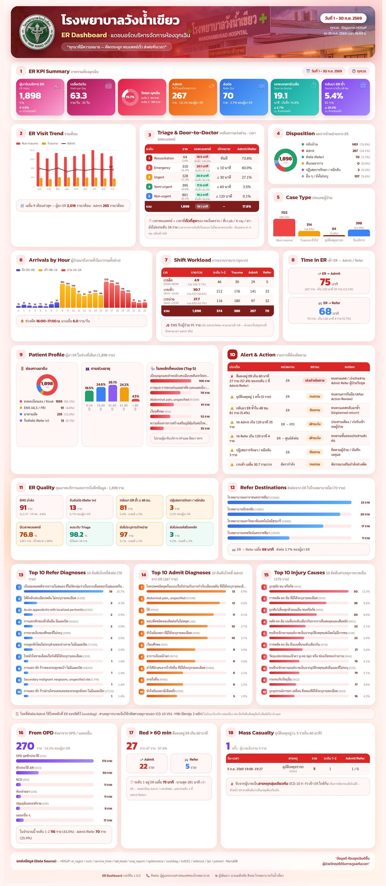

# ER Dashboard — แดชบอร์ดบริหารจัดการห้องฉุกเฉิน (HOSxP)

> **เวอร์ชัน 1.1.0** — ใช้ได้กับโรงพยาบาลที่ใช้ HOSxP · **คู่มือติดตั้ง (PDF): [docs/ER_Dashboard_install_manual.pdf](docs/ER_Dashboard_install_manual.pdf)** ·
> ดาวน์โหลดชุดติดตั้ง: [Releases](https://github.com/nopneo/er-dashboard-wnk/releases/latest) · สรุปขั้นตอน: [INSTALL.md](INSTALL.md) ·
> ความปลอดภัย: [SECURITY.md](SECURITY.md) · การเปลี่ยนแปลง: [CHANGELOG.md](CHANGELOG.md)

รายงานอินโฟกราฟิก 18 บล็อก ดึงข้อมูลสดจาก HOSxP (MariaDB `hos`) โทนแดง/ชมพู หน้าตาชุดเดียวกับ
[IPD Dashboard](https://github.com/nopneo/ipd-dashboard-wnk)
ใช้ได้ทั้งเป็น **เว็บ live** (เปิดจากมือถือได้ เพิ่มลงหน้าจอโฮมเป็นไอคอนแอป) และ **กดส่งออกเป็น JPG / PNG / PDF**
พร้อมรายงาน **พยาบาลตรวจแทนแพทย์ 16:00–20:00 น.** (มีรหัสเข้าดู, ส่งออก Excel)



## วิธีใช้

```bash
pip install -r requirements.txt
cp .env.example .env          # แก้ DB_USER / DB_PASS (บัญชีอ่านอย่างเดียว)
python app.py                 # http://127.0.0.1:6200/   (debug ปิด เปิดด้วย FLASK_DEBUG=1)
python render.py --d1 2026-09-01 --d2 2026-09-30 --fmt jpg
```

เลือกช่วงวันที่และเวรจากแถบด้านบน (`?d1=YYYY-MM-DD&d2=YYYY-MM-DD&shift=all|D|C|B`) · API ดิบ `GET /api/data.json`

## บล็อกในรายงาน

| # | บล็อก | ที่มาของข้อมูล |
|---|-------|----------------|
| 1 | ER KPI Summary | ผู้มา ER, เฉลี่ย/วัน, ระดับ 1-2, Admit, Refer, เวลาพบแพทย์, กลับมาซ้ำ ≤ 48 ชม. (เทียบช่วงก่อนหน้าที่ยาวเท่ากัน) |
| 2 | ER Visit Trend | `er_regist` รายเดือน 9 เดือน แยก Trauma (ICD S/T/V) / Non-trauma + เส้น Admit |
| 3 | Triage & Door-to-Doctor | ระดับ 1-5 × เวลาพบแพทย์เทียบเป้าหมาย × สัดส่วน Admit/Refer |
| 4 | Disposition | `er_regist.er_dch_type` |
| 5 | Case Type | Non-trauma / Trauma ทั่วไป / จราจร / รับบริการ |
| 6 | Arrivals by Hour | `enter_er_time` รายชั่วโมง ระบายสีตามเวร |
| 7 | Shift Workload | ราย/เวร, ระดับ 1-2, Trauma, Admit, Refer รายเวร |
| 8 | Time in ER | เข้า ER → ลงทะเบียน Admit (`ipt`) / เวลาส่งต่อ (`referout`) |
| 9 | Patient Profile | ช่องทางมาถึง (`ovst.ovstist`), อายุ, โรคหลักที่พบบ่อย |
| 10 | Alert & Action | เกณฑ์เฝ้าระวังในโค้ด (`queries.alerts`) — ประเด็นด้านการบันทึกแสดงเป็น "ข้อสังเกต" |
| 11 | ER Quality | EMS, Refer in, กลับมาซ้ำ, ปฏิเสธ/หนี, ความครบถ้วนของการบันทึก |
| 12 | Refer Destinations | `referout.refer_hospcode` × `hospcode` |
| 13-14 | Top 10 Refer / Admit Diagnoses | โรคหลักที่ ER ลงรหัส (`ovstdiag`) |
| 15 | Top 10 Injury Causes | รหัสสาเหตุภายนอก ICD-10 V01–Y98 (3 หลัก) |
| 16 | From OPD | ลงทะเบียนครั้งแรกที่แผนกอื่น (`ovst.main_dep`) แล้วส่งมา ER |
| 17 | Red > 60 min | ระดับ 1 ที่ Admit/Refer อยู่ใน ER เกิน 60 นาที |
| 18 | Mass Casualty | ผู้บาดเจ็บสาเหตุกลุ่มเดียวกัน ≥ 5 รายใน 60 นาที (หน้าต่างเลื่อน) พร้อมรหัส ICD |

ตัวเลขทุกตัวมาจากฐานข้อมูลจริง ไม่มีค่าสมมติ · ไม่แสดงจำนวนผู้เสียชีวิต

## รายงานพยาบาลตรวจแทนแพทย์ 16:00–20:00 น. (`/nurse`)

ปุ่ม "🩺 พยาบาลตรวจแทนแพทย์" บนแถบด้านบน · ค่าเริ่มต้นแสดงตั้งแต่ต้นปีงบประมาณที่แล้ว · ดาวน์โหลด Excel ที่ `/nurse.xlsx?d1=&d2=`

- ผู้ป่วยในช่วง = เข้า ER (`enter_er_time`) 16:00:00–20:00:59 · ผู้ตรวจ = ผู้ลงโรคหลัก (`ovstdiag`) ถ้าว่างใช้ `ovst.doctor`
- พยาบาล = `doctor.provider_type_code` 03 · **ตรวจแทนแพทย์** ไม่รวมงานบริการ — ผู้ป่วยรับบริการอื่น ๆ (`er_pt_type` 4 ทำแผล ฉีดยา)
  และโรคหลัก Z48 (ทำแผล ตัดไหม) / Z23–Z27 (วัคซีน) — ซึ่งแยกนับเป็น "พยาบาลให้บริการ"
- ปีงบประมาณ ต.ค.–ก.ย. · เฉลี่ยต่อเดือนคิดเฉพาะเดือนที่ครบ · วันหยุดจากตาราง `holiday`
- ชื่อพยาบาลแสดงนามสกุลบางส่วน เช่น "นางสาวสมศรี ใจxxx"
- **ต้องใส่รหัสเข้าดู** `ER_NP_PASS_HASH` (ไม่ตั้ง = ปิดรายงาน) — ครอบทั้งหน้าเว็บ, Excel และปุ่มส่งออก JPG/PDF ·
  อยู่ในระบบ 12 ชม. · ใส่ผิด 10 ครั้งพัก 15 นาที · วิธีตั้งรหัสดู INSTALL.md

## เวลาพบแพทย์ (Door-to-Doctor)

HOSxP ของหลายโรงพยาบาลไม่ได้ลงเวลาพบแพทย์จริงใน `er_regist` (`doctor_tx_time` มักเป็นค่าตั้งต้น)
แดชบอร์ดจึงใช้ **"การกระทำแรกของแพทย์"** = เวลาที่เร็วที่สุดของ กดเริ่มตรวจ (`service_time`, ตั้งคอลัมน์ด้วย
`ER_ST_DOCTOR_COL`) / สั่ง Lab (`lab_head`) / สั่ง X-ray (`xray_report`) / สั่งยา (`opitemrece` + `drugitems`) /
เวลาที่พยาบาลจดไว้ใน HPI (`opdscreen.hpi`) เช่น "รายงานแพทย์ at 09.15", "10.30 น. แพทย์", "consult 09.30"
นับเฉพาะ 0–240 นาทีหลังเข้า ER · ตัวเลขนี้มาจากการบันทึก ไม่ใช่เวลาตรวจจริง จึงแสดง % ความครอบคลุมคู่กันเสมอ

## เกณฑ์การนับ

- **ไม่นับเคสที่ลงทะเบียน ER แต่ไม่ได้คัดกรอง** (ไม่มี `er_emergency_level_id` หรือ `er_pt_type` = ส่งมาผิด) ในทุกบล็อกและรายงานพยาบาล
  — แสดงจำนวนที่ไม่นับในบล็อก 3 และ 11
- **กลับมา ER ซ้ำ ≤ 48 ชม.** ไม่นับรับบริการ (`er_pt_type` 4), มาตามนัด (`ovstist` 02) และโรคหลักรหัส Z ทั้งครั้งนี้และครั้งก่อน

## การเชื่อมต่อฐานข้อมูล

`db.py` มี 2 โหมด เลือกด้วย `ER_DB_MODE` (ตั้ง `DB_PASS` = `direct` อัตโนมัติ)

- `direct` — ต่อ MariaDB ตรงด้วย PyMySQL อ่านค่าจาก `.env` (ใช้บนเซิร์ฟเวอร์จริง) ตั้ง session เป็น READ ONLY ให้เอง
- `ssh` — ยิงผ่าน `ssh $ER_SSH_HOST mariadb hos` (ใช้ตอนพัฒนาบนเครื่องที่ไม่มีรหัส DB)

HOSxP เก็บข้อมูลเป็น **tis-620** โค้ดตั้ง charset ให้แล้ว

## ความปลอดภัยและความเป็นส่วนตัว

- แสดงเฉพาะข้อมูลรวม **ไม่มี HN / ชื่อผู้ป่วย** ไม่เรียกทรัพยากรภายนอก (ฟอนต์ฝังในเครื่อง)
- พารามิเตอร์ (`d1`, `d2`, `shift`) ถูกตรวจรูปแบบก่อนเข้า SQL · ช่วงวันที่จำกัด `ER_MAX_DAYS` (366)
- รายละเอียดและสิ่งที่ต้องตั้งที่ proxy: [SECURITY.md](SECURITY.md)

ใบอนุญาต MIT — ดู [LICENSE](LICENSE) และ [NOTICE.md](NOTICE.md)
